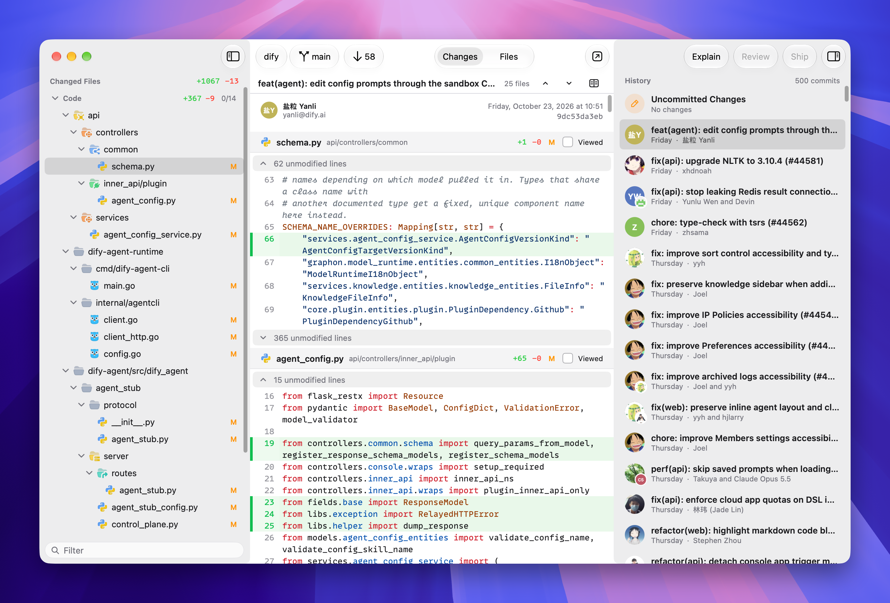
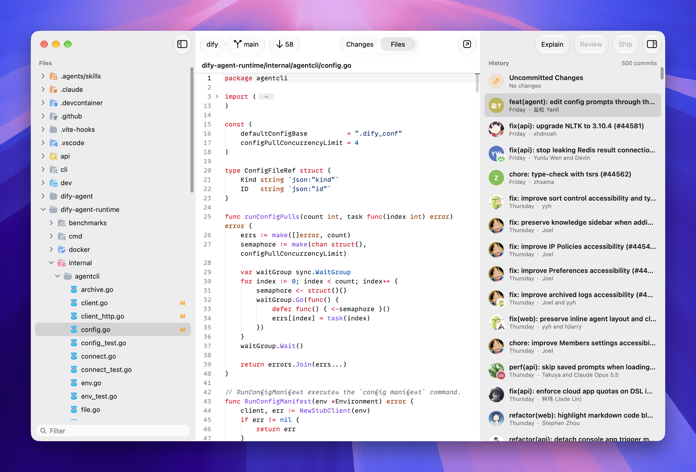

# Peek

A native git diff viewer for macOS, built in Go with [MyGo](https://github.com/egoist/mygo).

Open a repository and peek at its history: what each commit changed, the uncommitted changes in the work tree, and every file as the commit has it. Repositories open in one window, switched from the project's name in the toolbar, and it refreshes as the repository changes.

## Changes

The files the chosen commit changes, with its message above their diffs stacked one after another, and the history at the right.

<picture>
  <source media="(prefers-color-scheme: dark)" srcset="docs/changes-dark.png">
  
</picture>

## Files

All of the commit's files, to read any of them as it was then.

<picture>
  <source media="(prefers-color-scheme: dark)" srcset="docs/files-dark.png">
  
</picture>

## Features

- The uncommitted changes always at the top of the history
- Changed files grouped into code, tests, docs and lockfiles or generated files, with their added and deleted lines, and each diff marked viewed once read; tests, docs and generated files start folded as viewed, and a viewed diff opens again when chosen in the sidebar
- Filter the sidebar's files by path
- Syntax-highlighted diffs, with unmodified lines and imports folded away, unified or side by side
- Step through the changes of all the files with Next and Previous Change
- Select lines by their numbers to copy a reference to them, or their link on GitHub
- Comment on lines from the gutter, and copy the comments as a prompt for an agent
- The findings of a Codex review shown under the lines they are about
- Files too large to show whole shown as their patch
- Pictures shown as pictures, and Markdown files as a preview with the repository's images, with a toggle to the source
- File and folder icons from the icon theme VS Code is set to, when it draws SVGs (as [Flow Icons](https://github.com/thang-nm/Flow-Icons) does), or else from [file-icons](https://github.com/file-icons/atom)
- Authors' and co-authors' avatars, the commit's details and message on hover, references such as `#123` linked to their pull request or issue, and a link to the branch on GitHub
- One window for every repository, switched from the project's name in the toolbar or Peek's menu bar item, each kept as you left it, and the repositories open at quitting opened again
- Switch branches, or check out a pull request by number or link with the [GitHub CLI](https://cli.github.com), from the branch in the toolbar
- Fetches the branch's remote every few minutes, shows how many new commits it has beside the branch, and pulls them by fast-forward with a click
- **Ship**: commit all changes with a Codex-written message and push, from the history's toolbar
- **Review**: have Codex review the uncommitted changes or the unpushed commits, from the history's toolbar
- **Explain**: have Codex explain the changes shown, the uncommitted changes, a commit or the branch's, from the history's toolbar
- **Show in Menu Bar**, in the app menu, puts Peek in the menu bar in place of the Dock: its menu lists the recent repositories with their branches and the files they change, and the commits to pull, pulled with a click, whose count shows beside its icon; a right click brings Peek to the front
- **Hide When Inactive**, in the app menu, hides Peek as another app comes to the front
- The remotes' new commits counted on the Dock icon, while it shows
- A notification when shipping or a review finishes while Peek is in the background
- Fetches wait while offline or on a metered connection, and run as the network comes back
- Every command in the menu bar, as Mac apps have them
- Follows the system's light and dark appearance

## Shortcuts

| Shortcut | Action |
| --- | --- |
| <kbd>⌘</kbd> <kbd>O</kbd> | Open a folder |
| <kbd>⌘</kbd> <kbd>1</kbd> | Changes mode |
| <kbd>⌘</kbd> <kbd>2</kbd> | Files mode |
| <kbd>⌃</kbd> <kbd>⌘</kbd> <kbd>S</kbd> | Show or hide the sidebar |
| <kbd>⌃</kbd> <kbd>⌘</kbd> <kbd>I</kbd> | Show or hide the history |
| <kbd>⌥</kbd> <kbd>⌘</kbd> <kbd>V</kbd> | Mark the chosen file's diff as viewed |
| <kbd>⌃</kbd> <kbd>⌘</kbd> <kbd>D</kbd> | Show the diffs side by side or unified |
| <kbd>⌃</kbd> <kbd>⌘</kbd> <kbd>↓</kbd> / <kbd>⌃</kbd> <kbd>⌘</kbd> <kbd>↑</kbd> | Next / previous change |
| <kbd>⌘</kbd> <kbd>F</kbd> | Find in the file |
| <kbd>⌘</kbd> <kbd>G</kbd> / <kbd>⇧</kbd> <kbd>⌘</kbd> <kbd>G</kbd> | Find next / previous |
| <kbd>⌘</kbd> <kbd>E</kbd> | Use the selection for Find |
| <kbd>⌥</kbd> <kbd>⌘</kbd> <kbd>J</kbd> | Filter the sidebar's files |
| <kbd>⌘</kbd> <kbd>R</kbd> | Refresh |
| <kbd>⌘</kbd> <kbd>B</kbd> | Switch branch or check out a pull request |
| <kbd>⇧</kbd> <kbd>⌘</kbd> <kbd>P</kbd> | Pull |
| <kbd>⌘</kbd> <kbd>P</kbd> | Ship |
| <kbd>⇧</kbd> <kbd>⌘</kbd> <kbd>R</kbd> | Review changes |
| <kbd>⇧</kbd> <kbd>⌘</kbd> <kbd>E</kbd> | Explain changes |
| <kbd>⌥</kbd> <kbd>⌘</kbd> <kbd>R</kbd> | Show the repository in Finder |

## Usage

Requires Go 1.27 or later, and `git` on your `PATH`.

```bash
go run . path/to/repository
```

Without a path, Peek opens the repository you are in, or else the ones open when it last quit.

### Ship with Codex

Install the Codex CLI and sign in with `codex login`. Click **Ship** in the
history's toolbar (or press <kbd>⌘</kbd> <kbd>P</kbd>) to stage all changes, including untracked files (Git ignores still
apply). Peek embeds the staged diff and the recent commit subjects in the
prompt, so Codex can write the message in one turn, following the
repository's commit style. Diffs are grouped code first, then tests, docs,
and last lockfiles and generated files; each file's diff is capped, and a
change too large to embed whole comes with a summary of every file, leaving
Codex to read more of the fixed staged tree in a read-only sandbox only if it
must. The message is written by a small, fast model with low reasoning,
apart from your Codex config, whose plugins and hooks suit coding sessions.
Before committing, Peek verifies that the branch, HEAD and staged tree are
unchanged.

Peek fetches the remote, commits, then pushes the current branch. If the remote
explicitly rejects it because the branch is protected, Peek creates and switches
to a `peek/push-…` branch and pushes that instead. A detached HEAD also gets a new
branch. With no new changes, Ship sends existing commits without calling Codex.
Git's push-remote settings are respected; otherwise Peek uses `origin` or the
only configured remote. No pull request is created.

The Ship button shows progress and the result; hover it for details. Click it
while running to cancel, or after a failure to retry. Authentication, network and
non-fast-forward failures stop the operation; Peek does not force-push or
automatically merge. Failed attempts retain staged changes and any local commit
for a retry.

### Review with Codex

Click **Review** in the history's toolbar (or press <kbd>⇧</kbd> <kbd>⌘</kbd> <kbd>R</kbd>) to review staged, unstaged and untracked changes. When the
working tree is clean, it reviews commits not yet pushed to the configured
push destination, using locally known remote refs. A new branch is compared
with the remote's default branch (or `main` / `master` when needed).

While running, the button shows the current stage (starting, inspecting,
reviewing or checking) and elapsed time. Hover for the current operation.
Stages follow live Codex events rather than an estimated percentage.
When finished, it shows **Passed**, **Not Passed**, or **Review Error**.
Peek judges the result by the findings' priorities: any P0–P2 finding fails
the review, while minor P3 findings alone still pass and show with it.
Click a completed result to read the summary and findings, copy them, or
review again. A failed review automatically copies them to the clipboard.
Click while running to cancel. Changing the reviewed code makes the result
out of date, and the button offers **Review Again**. With no changes to review, the button is disabled.

Review uses your existing Codex login and settings. Peek supplies the repository,
review scope and fixed commit IDs; Codex reads the Git diffs and relevant files
itself in a read-only sandbox, using your configured provider. File contents
and binary assets are not embedded in the prompt. Peek fingerprints changed
files with streaming hashes to detect outdated reviews.
It leaves the index and working tree unchanged. Review is independent of Ship;
a failed review does not prevent a later push. The two operations cannot run
at the same time. Review has no assembled-diff size limit; Git metadata output
is still bounded. Dirty submodules must be committed or cleaned before
reviewing, including untracked files inside them.

### Explain with Codex

Click **Explain** in the history's toolbar (or press <kbd>⇧</kbd> <kbd>⌘</kbd> <kbd>E</kbd>) to have Codex
explain the changes of the entry chosen in the history: the uncommitted changes, a commit, or the branch's
changes. As for a review, Peek only tells Codex where the changes are, and Codex reads them and the code
around them itself, in a read-only sandbox with your settings. Once it is ready the button reads **Explanation**;
click it to read it, in Markdown, copy it, or explain again. An explanation of the uncommitted
changes goes out of date as they change.

To build `Peek.app` and a `.dmg` into `build/`:

```bash
go tool mygo build
```

## Development

```bash
CGO_ENABLED=0 go test ./...
```

The screenshots above are of the installed Peek's window, over a clone of [Dify](https://github.com/langgenius/dify) with `main` at commit `9dc53da` ([#44561](https://github.com/langgenius/dify/pull/44561)), whose `origin` is the GitHub repository and `origin/main` 58 commits on: that commit in Changes, and `dify-agent-runtime/internal/agentcli/config.go` in Files, in the light and the dark appearance, the window as the screen shows it, its sidebars' glass over the desktop's wallpaper, with its shadow. Take them again, into `docs/`, from a clone of Dify of your own:

```bash
scripts/screenshots.sh path/to/dify
```

It needs Screen Recording for the app it runs in, and switches the appearance through System Events; Peek's saved projects and window, and the appearance, are put back after.

## License

[MIT](LICENSE). The icon fonts in [internal/fileicons/fonts](internal/fileicons/fonts) keep their own licenses, listed in its [NOTICE](internal/fileicons/fonts/NOTICE).
